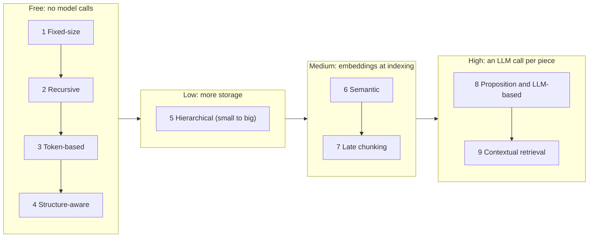
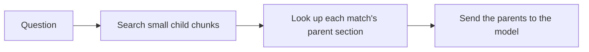
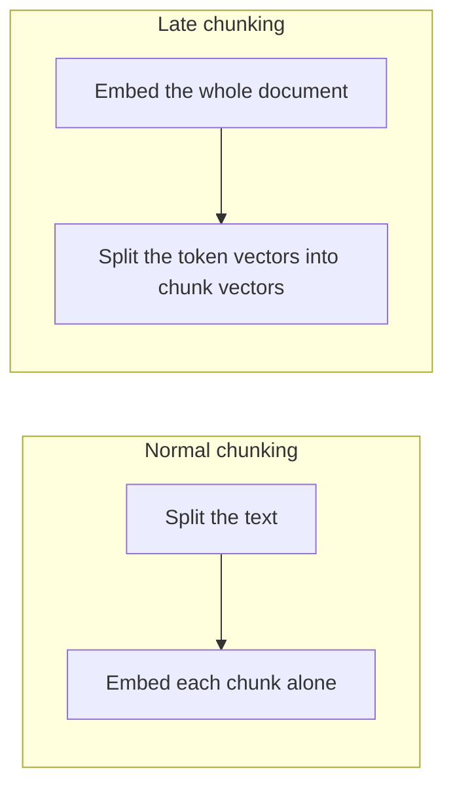
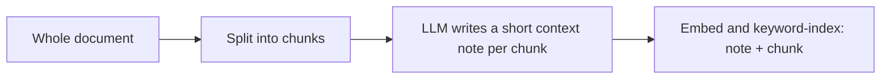
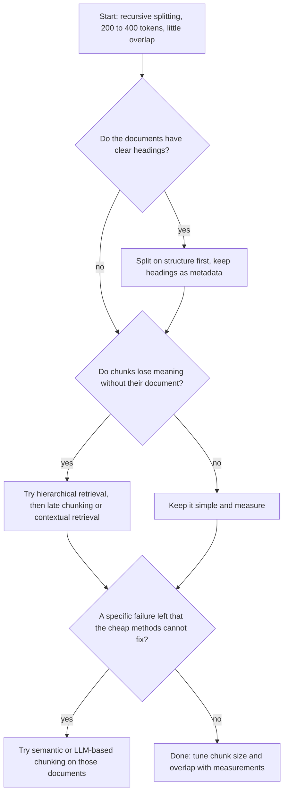

# Chunking Strategies for RAG: From Cheap and Old to Expensive and New

Notes on how to split documents for retrieval, ordered from the oldest and cheapest method to the newest and most expensive one. Each method has how it works, pros, cons, cost, and the LangChain tool where one exists.

**About the evidence.** The figures in section 4 come from the papers and reports listed in the sources, as retrieved by search. I did not read each paper in full, so check the original before quoting a number. I ignored blog posts that gave cost multipliers such as "10 times slower", because the sources disagreed with each other. No code was run to produce these notes.

---

## 1. What chunking is and why it matters

A RAG system cannot embed a whole document and expect precise answers. It splits each document into **chunks**, embeds each chunk, and at question time retrieves the few chunks closest to the question. Chunking decides what unit of text the system can find, and what the model gets to read.

The trade-off that drives every choice:

| Smaller chunks | Larger chunks |
|---|---|
| Precise matches, little noise | More surrounding context |
| Each chunk may be too short to make sense alone | One chunk can mix several topics, which dilutes its embedding |
| More chunks, so a bigger index | Fewer chunks, so a smaller index |
| Less context sent to the model per hit | More tokens sent to the model per hit |

**Characters versus tokens.** LangChain splitters count `chunk_size` in **characters** by default. As a rough rule for English, one token is about four characters, so 1000 characters is about 250 tokens. Code, Arabic, and other languages tokenize differently.

### Three kinds of cost

1. **Indexing compute:** whether ingestion needs embedding calls or LLM calls.
2. **Index size:** more chunks mean more storage and slower search.
3. **Complexity:** more code to maintain and more ways to fail.

---

## 2. The evolution, from old and cheap to new and expensive



| # | Method | Era | Model calls at indexing | Cost | LangChain tool |
|---|---|---|---|---|---|
| 1 | Fixed-size splitting | 2022 to 2023 | None | Free | `CharacterTextSplitter` |
| 2 | Recursive splitting | 2023 | None | Free | `RecursiveCharacterTextSplitter` |
| 3 | Token-based splitting | 2023 | None | Free | `TokenTextSplitter`, `from_tiktoken_encoder` |
| 4 | Structure-aware splitting | 2023 to 2024 | None | Free | `MarkdownHeaderTextSplitter`, `HTMLHeaderTextSplitter` |
| 5 | Hierarchical (small to big) | 2023 to 2024 | None | Low, more storage | Parent-document retriever pattern |
| 6 | Semantic chunking | 2023 to 2024 | Embeddings for every sentence | Medium | `SemanticChunker` (`langchain_experimental`) |
| 7 | Late chunking | 2024 | A long-context embedding model | Medium | Provided by the embedding model |
| 8 | Proposition and LLM-based chunking | 2023 to 2025 | An LLM call per passage | High | Custom code |
| 9 | Contextual retrieval | 2024 | An LLM call per chunk | High, but cacheable | Custom pipeline |

The era column is approximate. Class locations in LangChain move between versions, for example some older retrievers now live in `langchain_classic`, so check your installed version.

---

## 3. The methods, one by one

### Tier 1: free methods, no model needed

#### 3.1 Fixed-size splitting

Cuts text at a character count, or at one separator such as a blank line, then merges pieces up to the size limit.

- **Pros:** the fastest and simplest method. Predictable and easy to debug.
- **Cons:** can cut a sentence or an idea in half. It does not enforce the limit strictly: `CharacterTextSplitter` can produce chunks longer than `chunk_size` when a piece has no separator inside it.
- **Cost:** none.

#### 3.2 Recursive splitting

Tries the largest separator first (paragraphs), then lines, then sentences and words, and cuts mid-word only as a last resort.

- **Pros:** respects natural boundaries with no model, enforces the size limit, and is the most common default recommendation.
- **Cons:** still blind to meaning. It does not know where a topic really changes.
- **Cost:** none.

#### 3.3 Token-based splitting

Counts tokens instead of characters.

- **Pros:** chunk sizes match what the embedding model actually sees, so you can respect its limit.
- **Cons:** needs a tokenizer. It cuts as blindly as fixed-size splitting.
- **Cost:** none.

#### 3.4 Structure-aware splitting

Splits on headings, pages, or code blocks, and can keep the heading as metadata. Unstructured's loaders also offer strategies such as `by_title`, `by_page`, and `by_similarity` next to the `basic` one.

- **Pros:** chunks follow how the author organized the text, and the metadata helps filtering and citations.
- **Cons:** only works when the document has clean structure. Scanned PDFs and messy HTML often do not.
- **Cost:** none.

### Tier 2: low cost, more storage

#### 3.5 Hierarchical (small to big)

You search over small chunks for precision, then give the model the larger parent section for context. A variant indexes single sentences and returns a window around the match.



- **Pros:** precise matching and enough surrounding text for a good answer.
- **Cons:** two layers to store and keep in sync, and more tokens go to the model per hit.
- **Cost:** low compute, more storage.

### Tier 3: medium cost, embeddings at indexing time

#### 3.6 Semantic chunking

Embeds each sentence and starts a new chunk where meaning shifts, meaning where adjacent sentences are far apart in embedding space.

- **Pros:** boundaries follow topic changes, so chunks are more coherent.
- **Cons:** needs an embedding call for every sentence. Chunks can be tiny or uneven, and one study found it produced many more chunks than other methods (section 4).
- **Cost:** medium.

#### 3.7 Late chunking

Runs a long-context embedding model over the whole document first, then splits the resulting token vectors into chunk vectors. Each chunk vector carries information from the full document.



- **Pros:** helps chunks that mean little alone, such as one that only says "it increased by 3%", with no LLM call.
- **Cons:** needs an embedding model with a long context window, and the document must fit in that window.
- **Cost:** medium.

### Tier 4: expensive, an LLM call per piece

#### 3.8 Proposition and LLM-based chunking

An LLM rewrites text into standalone factual statements called propositions, or an LLM decides where the boundaries go. Research names include Dense X retrieval (propositions) and LumberChunker (LLM-chosen boundaries).

- **Pros:** the most meaningful units, because each can stand alone.
- **Cons:** an LLM call across your whole corpus, slow to re-index, and the output depends on the model's judgment, which can vary between runs.
- **Cost:** high.

#### 3.9 Contextual retrieval (Anthropic)

For each chunk, an LLM writes a short note placing it in its document, such as "This chunk is from ACME's Q2 report". The note is added to the chunk before embedding and before keyword indexing.



- **Pros:** per Anthropic's post, contextual embeddings alone cut the top-20 retrieval failure rate by 35%, combined with keyword search by 49%, and with reranking on top by 67%.
- **Cons:** an LLM call per chunk, and re-running it when documents change. It fixes missing context but not bad chunk boundaries. Anthropic also notes that a knowledge base under about 200,000 tokens can simply go in the prompt.
- **Cost:** high, but Anthropic estimated a one-time cost of about $1.02 per million document tokens with prompt caching, under its stated assumptions (800-token chunks, 8k-token documents, 100 tokens of context per chunk).

---

## 4. What the evidence says: expensive is not automatically better

| Source | Finding |
|---|---|
| Chroma, "Evaluating Chunking Strategies for Retrieval" (2024) | A plain recursive splitter at 200 tokens with no overlap performed consistently well: about 88% recall and 7% precision when retrieving 5 chunks. At 800 tokens with 400 overlap, recall was about 85% and precision about 1.5%. A cluster-based semantic chunker was best on precision at 200 tokens (about 8%), and an LLM-based chunker had the highest recall (about 92%), but the gaps were small. The report suggests starting with recursive splitting at 200 to 400 tokens and little overlap. |
| Qu et al., NAACL 2025 Findings, "Is Semantic Chunking Worth the Computational Cost?" | Semantic chunking's extra compute was not justified by consistent gains. Fixed-size chunking won on several datasets. |
| A study of oil and gas enterprise documents (arXiv 2603.24556) | Structure-aware chunking produced far fewer chunks (911) than fixed (4,014), recursive (2,637), or semantic (10,685) chunking. Fewer chunks mean a smaller index and faster search. |
| Splunk's survey of the research | Across 1,080 configurations, paragraph-based chunking roughly doubled ranking quality against fixed character chunking. Swapping the embedding model gave a bigger average gain than any chunking difference. Advanced methods such as contextual or late chunking are advised only for specific, identified failures. |
| A comparison of chunking methods against compute cost (arXiv 2606.00881) | Fixed-size was the cheapest. LLM-based chunkers were the most expensive. |

**How to read this.** These results come from particular datasets and embedding models, so they will not transfer exactly to yours. The consistent message is: a well-parametrized simple splitter is a strong baseline, and complexity should be added only to fix a failure you measured.

---

## 5. Chunk size and overlap

- **Size:** measured in the tokens the embedding model sees. Chroma's results favored about 200 to 400 tokens. Larger chunks carry more context but dilute precision and cost more per retrieved chunk.
- **Overlap:** repeats the end of one chunk at the start of the next, so a fact on a boundary is not lost. The price is duplicated text, a bigger index, and near-duplicate results. Chroma's best setting used no overlap, so treat overlap as insurance and measure whether you need it.
- **Retrieved budget:** the text the model reads per question is roughly `k` times the chunk size. Changing the chunk size also changes how much context you pay for.

---

## 6. How this applies to my three RAG projects

| Project | Setting in the code | Approximate reading |
|---|---|---|
| `rag-gist` | `CharacterTextSplitter`, 1000 characters, 200 overlap, `k=3` | About 250 tokens per chunk, near the sweet spot. The run warned about chunks of 1180 and 1058 characters, so the limit is not enforced. Recursive splitting would enforce it. |
| Documentation Helper | `RecursiveCharacterTextSplitter`, 4000 characters, 200 overlap, default retriever settings | About 1000 tokens per chunk, large but reasonable for structured documentation. The crawl produced 142 chunks from 28 pages. Splitting on headings might suit these pages better. |
| Agentic RAG | `UnstructuredLoader` with `chunking_strategy="basic"` and `max_characters=100000`, then `RecursiveCharacterTextSplitter`, 250 characters, 0 overlap, `k=3` | About 60 tokens per chunk, so about 190 tokens of context per question, which is well below the 200 to 400 token range in Chroma's results. Because `max_characters` is huge, Unstructured's own chunker rarely splits, and the recursive splitter does the real work. |

One thing to test in Agentic RAG, not a measured fact: the relevance grader judges each tiny chunk alone, so a chunk too short to look relevant may make the web search fallback fire more often.

---

## 7. How to choose



### A small evaluation loop

Not run here. It is a sketch to adapt.

1. Write 20 to 30 questions, each with a short snippet from the passage that answers it.
2. For each chunk size and overlap setting, rebuild the index and compute the hit rate: how often the snippet appears in the top `k` retrieved chunks.
3. Also record the average tokens retrieved per question.
4. Choose the cheapest setting that reaches your target hit rate.
5. Repeat when you change the embedding model.

```python
def hit_rate(retriever, eval_set):
    hits = 0
    for item in eval_set:
        docs = retriever.invoke(item["question"])
        if any(item["answer_snippet"] in d.page_content for d in docs):
            hits += 1
    return hits / len(eval_set)
```

A substring check misses answers that span two chunks, so treat the result as a floor.

---

## 8. Common mistakes

- Assuming `chunk_size` is in tokens when it is in characters.
- Trusting `CharacterTextSplitter` to enforce the size limit.
- Using large overlap by default, and paying for duplicated text without checking it helps.
- Choosing semantic or LLM-based chunking before measuring a failure.
- Changing the chunker and the embedding model at the same time, so you cannot tell which one helped.
- Using chunks so small that a grader or the model sees fragments with no meaning.
- Not testing retrieval with real questions before tuning anything.

---

## 9. Interview questions

1. **Why do we chunk documents for RAG?** To retrieve a precise, relevant unit of text instead of a whole document, within the embedding model's limits.
2. **What is the trade-off in chunk size?** Small chunks are precise but lack context. Large chunks have context but add noise and dilute the embedding.
3. **Recursive versus fixed-size splitting?** Recursive tries natural separators in order and enforces the size limit. Fixed-size cuts at a count or one separator.
4. **What does semantic chunking do, and what does it cost?** It starts a new chunk where sentence embeddings drift apart. It needs an embedding call per sentence and can produce many small chunks.
5. **What is late chunking?** Embed the whole document with a long-context model first, then pool the token vectors into chunk vectors, so each chunk carries document context.
6. **What is contextual retrieval?** An LLM prepends a short note to each chunk saying where it comes from before embedding and keyword indexing.
7. **What is small-to-big retrieval?** Search small chunks, return their larger parent sections.
8. **When is an expensive chunker worth it?** When a measured failure remains that a tuned recursive splitter cannot fix.
9. **How do you evaluate a chunking strategy?** With questions that have known source passages, measuring hit rate at `k` and tokens retrieved.

---

## 10. Mini project

1. Pick one project, such as Agentic RAG, and write 25 questions with answer snippets.
2. Measure the hit rate with the current 250-character chunks.
3. Rebuild the index at about 800 characters and at about 1600 characters, with zero overlap, and measure again.
4. Add 10% overlap to the best size and see whether the hit rate changes.
5. Record the average tokens retrieved per question for each setting.
6. Write up which setting you would ship and why.

---

## Sources

- [Chroma: Evaluating Chunking Strategies for Retrieval](https://research.trychroma.com/evaluating-chunking)
- [Anthropic: Contextual retrieval](https://www.anthropic.com/engineering/contextual-retrieval)
- [Qu et al.: Is Semantic Chunking Worth the Computational Cost? (ACL Anthology)](https://aclanthology.org/2025.findings-naacl.114/)
- [Evaluating Chunking Strategies for RAG in Oil and Gas Enterprise Documents (arXiv 2603.24556)](https://arxiv.org/pdf/2603.24556)
- [Chunking Methods on RAG: Effectiveness Evaluation Against Computational Cost (arXiv 2606.00881)](https://arxiv.org/pdf/2606.00881)
- [Splunk: Advanced chunking techniques, what the benchmarks show](https://www.splunk.com/en_us/blog/artificial-intelligence/chunking-techniques.html)