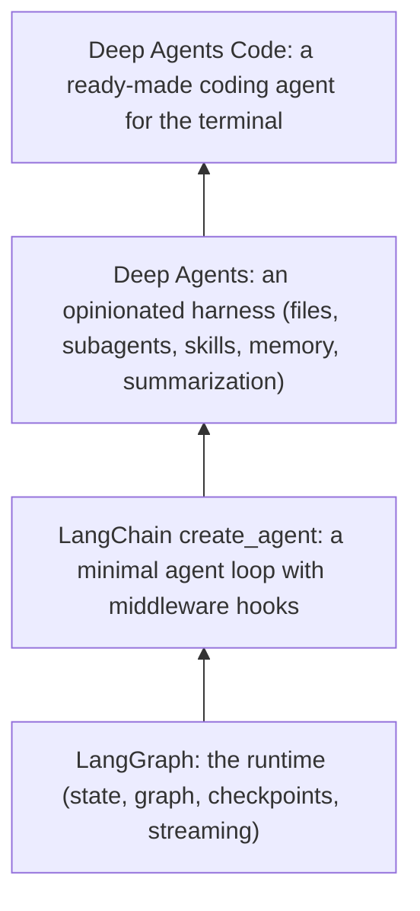
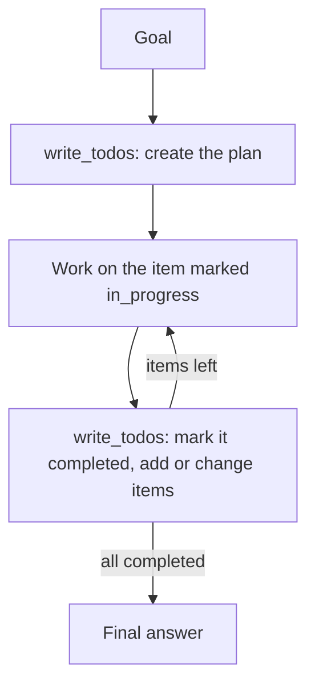
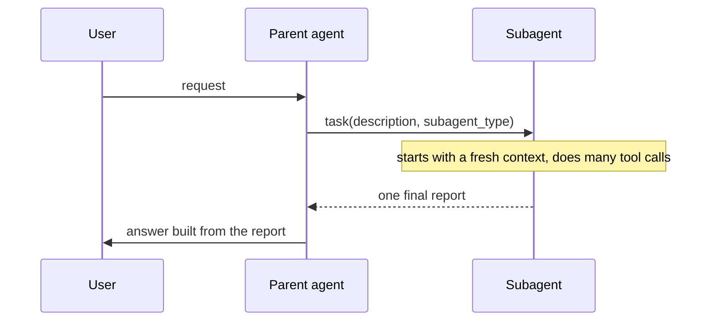
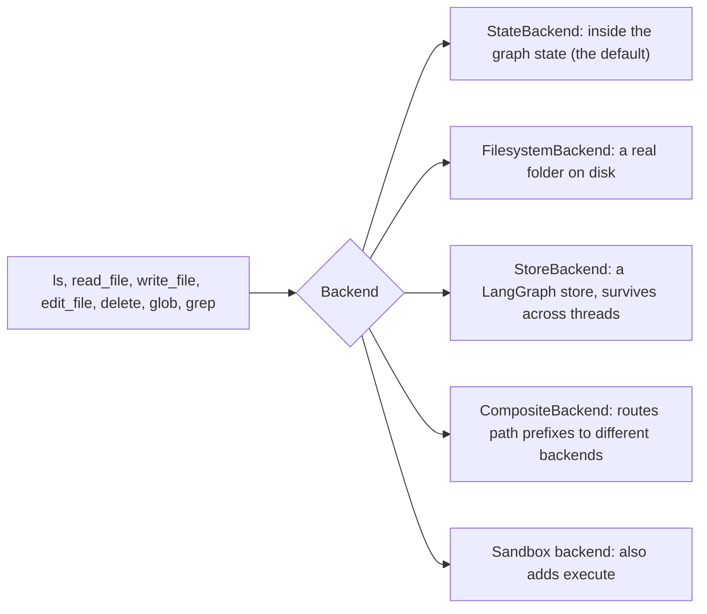
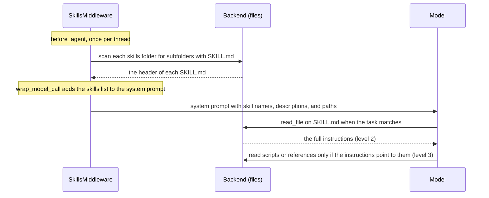
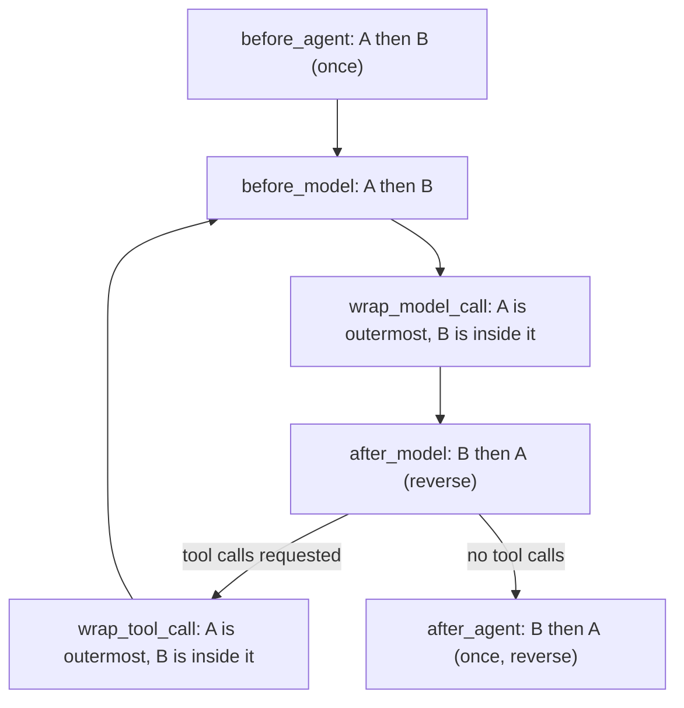
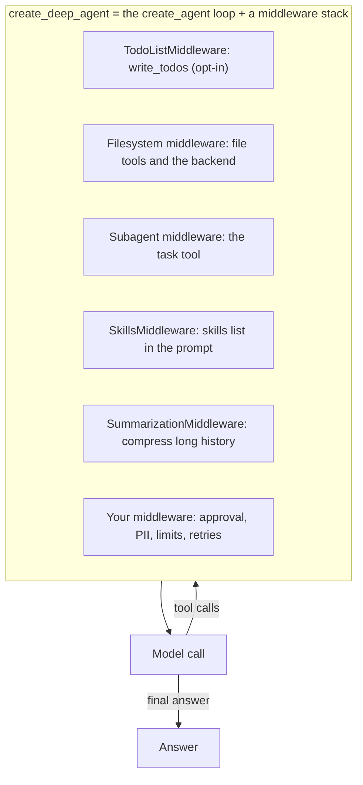

# Deep Agents: Planning, Subagents, File Systems, Skills, and Middleware

Notes from the Deep Agents section of the course (lectures 145 to 158). The sources are the LangChain blog and docs, the `deepagents` repository, and Remotion's agent skills docs.

Items marked **Verified** were checked by running code against `deepagents` 0.7.32 with `langchain` 1.4.7 and `langgraph` 1.2.x. The checks used a scripted stand-in model, so no API key was needed and no real model was called. The lectures may show older behavior, so section 9 lists what changed.

| Lectures | Topic | Section |
|---|---|---|
| 145, 146 | Introduction and the taxonomy of agents | 1 |
| 147 | Dynamic to-do lists | 2 |
| 149 | Subagents and context flow | 3 |
| 150 | File systems | 4 |
| 151 to 155 | Agent skills, three layers | 5 |
| 156 to 158 | Agent middleware, security and reliability | 6 |

---

## 1. The big picture

### What a deep agent is

A **deep agent** is an agent built on a **harness**: a ready-made set of tools, prompts, and behaviors wrapped around the normal "model calls tools in a loop" pattern. The docs describe Deep Agents as an open source agent harness, and the library as batteries included.



Everything from earlier lessons is still underneath: the agent loop, `ToolNode`, state, and tracing. A deep agent adds structure around that loop.

### Shallow, deep, and coding agents

| | Shallow agent | Deep agent | Coding agent |
|---|---|---|---|
| Loop | The model calls tools in a loop | The same loop, plus a harness around it | A deep agent whose main tools are a shell and code |
| Planning | None, or implicit in the chat | An explicit to-do list | Usually an explicit plan |
| Where work is kept | The chat history only | Files outside the context window | The project's own files |
| Delegation | None | Subagents with their own context | Subagents are common |
| Typical task | A few steps | Long tasks with many steps | Long tasks across a codebase |
| Examples | The ReAct agents from the earlier lessons | Deep research style agents | Claude Code, Deep Agents Code |

The LangChain blog describes deep agents as the pattern behind products like Claude Code and deep research agents, and names four ingredients: **a planning tool, subagents, a file system, and a detailed system prompt.** The current docs add skills, memory, and summarization.

### Why shallow agents struggle on long tasks, and the feature that answers each problem

| Problem | What goes wrong | Deep agent answer |
|---|---|---|
| Long tasks lose the thread | The model forgets the goal or skips steps | A to-do list it rewrites as it works |
| Tool output floods the context | One big result pushes out everything else | A file system to write results into, and subagents to absorb the noise |
| Specialized knowledge | Cramming every instruction into the prompt wastes tokens | Skills loaded only when needed |
| Context keeps growing | The window fills up | Summarization and offloading |
| Risky actions | The model can do anything its tools allow | Middleware, permissions, and approvals |

This is the same list of ideas as the context engineering notes. Section 7 maps them one to one.

---

## 2. Planning: dynamic to-do lists (lecture 147)

The planning tool is `write_todos`. The model uses it to create a structured task list, then updates the list as it works. Each item has a `content` string and a `status` of `pending`, `in_progress`, or `completed`.



**Why it works even though it does nothing.** `write_todos` does not execute anything. It only stores the list in the agent's state. Its value is context engineering: writing the plan forces the model to commit to steps, and the current list is visible on every later step, so the model keeps its place on a long task. The word **dynamic** means the plan is rewritten as the agent learns things, not fixed at the start.

**Version note. Verified:** in `deepagents` 0.7.32 the default tools do **not** include `write_todos`. The docs describe task planning as opt-in since version 0.7. Adding `TodoListMiddleware()` from `langchain.agents.middleware` makes `write_todos` appear. If a lecture shows planning working out of the box, it was recorded on an older version.

---

## 3. Subagents and context flow (lecture 149)

A subagent is a second agent that the main agent starts for one job. The main agent calls the built-in **`task`** tool with a `description` of the job and a `subagent_type`. The subagent works in its own context window and returns one final report.



**Verified context flow** (default isolated mode, scripted model):

- The subagent received **only the `description` string** as its human message. The parent's own user message, which I had marked with a secret word, was not passed down.
- The parent received **only the subagent's final message** as the result of the `task` call.

This is **context quarantine**. A research subagent can read twenty pages and run fifteen searches, and the parent's context only grows by one report.

What follows from this:

- **Write a complete `description`.** It is the subagent's whole briefing. Anything the parent knows and does not write there, the subagent does not know.
- **Subagents are short-lived.** Each call starts fresh and returns once. You cannot keep chatting with the same subagent.
- **Defining your own.** A subagent is configured with a name, a description (which the parent reads to decide when to delegate), a system prompt, and optionally its own tools and model.
- **Modes.** The docs describe an isolated mode (the default, shown above) and a fork mode in which the subagent inherits the parent's conversation. They also describe async subagents that run in the background. Check the docs for your version before relying on either.
- **When not to use them.** For a small task, a subagent adds a model call and a briefing to write, and gives nothing back.

---

## 4. File systems (lecture 150)

Deep agents get a **virtual file system** through ordinary tools. **Verified** default tool list in 0.7.32:

`ls`, `read_file`, `write_file`, `edit_file`, `delete`, `glob`, `grep`, and `task`.

A sandbox backend also adds `execute`, for running shell commands.

**Why a file system.**

- **Offloading.** The agent writes notes and large results into files instead of keeping them in the context window. This is the structured note-taking idea from the context engineering article.
- **Shared workspace.** The parent and its subagents can read the same files.
- **Skills and memory are files.** Section 5 depends on this.

The tools are fixed, and the **backend** decides where the files actually live:



| Backend | Use it when |
|---|---|
| State (default) | The files only matter during one run or thread |
| Filesystem | You want the agent to read and write real project files |
| Store | Files must persist across conversations |
| Composite | Some paths should persist or be real, others should not |
| Sandbox | The agent must run commands, in an isolated environment |

**Safety.** A filesystem backend can touch real files. Give it a `root_dir`, and use `virtual_mode=True` so paths are resolved inside that root, as in the example in section 8. The docs also describe permission rules (operation, path, allow or deny) for the file tools. They do not replace a sandbox for command execution.

---

## 5. Agent skills: three layers (lectures 151 to 155)

### What a skill is

A **skill** is a folder that teaches an agent how to do one kind of task. The folder must contain a file named `SKILL.md`. It can also contain scripts, reference documents, and templates.

```
video-skill/
  SKILL.md          instructions, with a small header at the top
  scripts/          optional helpers
  references/       optional extra documents
```

The top of `SKILL.md` is a YAML header (frontmatter):

```markdown
---
name: video-skill
description: Create short product videos with a code-based workflow. Use when the user asks for a video.
---

# Video Skill
Step 1 ... Step 2 ... Step 3 ...
```

Per the Agent Skills standard that `deepagents` implements, the `name` must match the folder name and use lowercase letters, digits, and hyphens (up to 64 characters), and the `description` is limited to 1024 characters. The standard is open, so the same skill folder works in other tools that support it.

**Remotion** is the real-world example from the lectures. It is a framework for creating videos with code (React), and it publishes agent skills so a coding agent learns its APIs and workflow. Installing them is a one-line command in the Remotion docs.

### The core idea: progressive disclosure

An agent could have fifty skills. Putting all of them in the prompt would burn thousands of tokens on every call. So skills load in three levels:

| Level | What the model sees | When |
|---|---|---|
| 1. Metadata | Each skill's `name`, `description`, and file path | Always, in the system prompt |
| 2. Instructions | The full body of `SKILL.md` | Only when the model decides the task matches, by reading the file |
| 3. Resources | Scripts, references, and templates | Only if the instructions point to them |

This is the **just in time** retrieval idea from the context engineering notes. The `description` is therefore the most important line in a skill: it is the only thing the model has when deciding whether to open the rest.

### Layer 1: using skills in the Deep Agents CLI (lecture 152)

The lectures call it the Deep Agents CLI. The current docs call it **Deep Agents Code**, so command names can differ from the lecture. Check `--help` on your install.

- The CLI looks for skills in user level and project level skills folders (see the CLI docs for the exact locations on your version).
- At startup it reads only each skill's `name` and `description`, which is level 1.
- Community skills, such as Remotion's, install into those folders with the `skills` tool. There is also a `skills` subcommand in the CLI for listing and creating skills.
- You can ask for something that matches a skill, and the agent opens it by itself.

### Layer 2: tracing skills with LangSmith (lectures 153 and 154)

A trace shows progressive disclosure happening. In a run that uses a skill, look for:

1. The first model call's **system prompt** contains an "Available Skills" list with names, descriptions, and paths, and **not** the skill body.
2. A **`read_file` tool call** on a path ending in `SKILL.md`.
3. Later model calls whose message history now **contains the skill body**.
4. Later tool calls that follow the skill's steps.

**Verified** with a one-skill agent and a scripted model: the first request's system prompt listed `video-skill` with its description and the path `/skills/video-skill/SKILL.md`. The skill body was **not** in that first request. After the model called `read_file` on that path, the body appeared in the second request.

The recap lecture's point follows from this: a skill is not a special tool. The skills mechanism is a system prompt section plus the ordinary file tools.

### Layer 3: inside `skills.py` (lecture 155)

The skills feature lives in a class called `SkillsMiddleware` in `deepagents/middleware/skills.py`. I read the installed copy of this file.



How it works, step by step:

1. **Configuration.** You give the middleware a backend and a list of source folders. If two folders define a skill with the same name, the later source wins.
2. **`before_agent` hook.** At the start of a thread, it scans each source folder, parses the YAML header of each `SKILL.md`, checks the rules, and stores the list in the agent's state. It does this once per thread and reuses the stored list.
3. **`wrap_model_call` hook.** Before each model call, it appends a skills section to the system message: the list (`name`, `description`, path) plus instructions for progressive disclosure.
4. **No special tool.** The model reads the skill with the normal `read_file` tool. That is why skills require a file backend.
5. **Placement matters.** Where the middleware sits in the stack changes what it sees, which is why the middleware order matters in section 6.

Newer versions of the file also support pinning skills and attaching tools to a skill. Read the class documentation in your installed version for the current behavior.

---

## 6. Agent middleware (lectures 156 to 158)

### What middleware is

**Middleware** is code that wraps the agent loop at fixed points, so you can observe or change what happens without rewriting the loop. You attach it with `create_agent(..., middleware=[...])`.

**A deep agent is itself a stack of middleware.** The to-do list is `TodoListMiddleware`. The file tools come from a filesystem middleware. The `task` tool comes from a subagent middleware. Skills come from `SkillsMiddleware`. Summarization, memory, and permissions are middleware too. Learning middleware is learning how the whole harness is built.

### The six hooks

| Hook | Runs | Typical use |
|---|---|---|
| `before_agent` | Once, at the start | Load things into state, validate the input |
| `before_model` | Before every model call | Trim or edit messages, count calls |
| `wrap_model_call` | Around every model call | Retry, fall back to another model, edit the request or response |
| `after_model` | After every model call | Inspect or edit the model's output |
| `wrap_tool_call` | Around every tool call | Retry, block, log, or edit a tool call |
| `after_agent` | Once, at the end | Clean up, save results |

The `before_*` and `after_*` hooks observe and update state. The `wrap_*` hooks sit around a call, so they can run it, skip it, run it again, or change it.

### Execution order

**Verified** with two logging middleware, `[A, B]`, and one tool call:



- The `before_*` hooks run in list order, and the `after_*` hooks run in **reverse** order.
- The `wrap_*` hooks nest like layers of an onion. The first middleware in the list is the outermost layer.
- One more rule, **verified**: `create_agent` rejects two instances of the same middleware class (`Please remove duplicate middleware instances`). Two logging layers need two subclasses.

### Built-in middleware

**Verified** list shipped with `langchain` 1.4.7:

`ContextEditingMiddleware`, `FilesystemFileSearchMiddleware`, `HumanInTheLoopMiddleware`, `LLMToolSelectorMiddleware`, `ModelCallLimitMiddleware`, `ModelFallbackMiddleware`, `ModelRetryMiddleware`, `PIIMiddleware`, `ProviderToolSearchMiddleware`, `ShellToolMiddleware`, `SummarizationMiddleware`, `TodoListMiddleware`, `ToolCallLimitMiddleware`, `ToolErrorMiddleware`, `ToolRetryMiddleware`.

### Use cases: security (lecture 158)

| Risk | Middleware | What it does |
|---|---|---|
| Sensitive data in prompts | `PIIMiddleware` | Detects personal data and masks, redacts, hashes, or blocks it before it reaches the model |
| Irreversible actions | `HumanInTheLoopMiddleware` | Pauses a tool call so a person can approve, edit, or reject it |
| Dangerous commands | A custom `wrap_tool_call` guard | Blocks a call by policy, as in the example below |
| Command execution | `ShellToolMiddleware` | Runs shell commands under an execution policy |

### Use cases: reliability

| Risk | Middleware | What it does |
|---|---|---|
| Temporary API failure | `ModelRetryMiddleware`, `ToolRetryMiddleware` | Retries the call |
| Provider outage | `ModelFallbackMiddleware` | Switches to another model |
| Tool errors | `ToolErrorMiddleware` | Turns a tool failure into a message the model can handle |
| Runaway loops and cost | `ModelCallLimitMiddleware`, `ToolCallLimitMiddleware` | Stops the run after a fixed number of calls |
| Context overflow | `SummarizationMiddleware`, `ContextEditingMiddleware` | Compresses or edits old messages |
| Too many tools | `LLMToolSelectorMiddleware` | Shows the model only the relevant tools |

### A security guard, verified

```python
from langchain.agents.middleware import AgentMiddleware
from langchain_core.messages import ToolMessage


class Guard(AgentMiddleware):
    def wrap_tool_call(self, request, handler):
        call = request.tool_call
        if call["name"] == "run_command" and "rm" in call["args"].get("cmd", ""):
            return ToolMessage(
                content="Blocked by policy: destructive command",
                tool_call_id=call["id"],
                name=call["name"],
            )
        return handler(request)
```

Tested with a scripted model that asked for `run_command` with `rm -rf /`: **the tool function never ran**, and the model only saw the message "Blocked by policy: destructive command". The check is a plain keyword test, which a real attacker can get around. It shows the shape of a guard, not a complete one.

### The principle behind it

The `deepagents` README describes a **trust the LLM** model: the agent can do anything its tools allow. Boundaries must be enforced at the tool or sandbox level, not by asking the model to behave. Middleware, permissions, and sandboxes are that enforcement layer. This is the same lesson as the MCP security notes: a tool description or tool result is text the model may obey, so the guard belongs in code that the model cannot talk its way past.

---

## 7. How everything connects



**One task, end to end** (an illustration, not a trace). The user asks for a short product video, and a Remotion skill is installed.

1. The system prompt lists the skills (level 1 of progressive disclosure).
2. If planning is enabled, the agent writes a to-do list.
3. The agent reads `SKILL.md` through `read_file` (level 2).
4. It delegates research to a subagent, which reads many pages and returns one report.
5. It writes scripts and notes into files instead of keeping them in context.
6. It runs commands in a sandbox. An approval middleware pauses before anything risky.
7. A summarization middleware compresses the history when it grows.
8. LangSmith shows every step in one trace.

**The same ideas as the context engineering notes:**

| Context engineering idea | Deep agent feature |
|---|---|
| Compaction | Summarization and offloading |
| Structured note-taking | The file system and memory files |
| Sub-agent architectures | The `task` tool and context isolation |
| Just in time retrieval | Skills with progressive disclosure |
| Minimal, high-signal context | The to-do list, and tool selection |

A deep agent is those strategies packaged as default behavior.

---

## 8. A minimal deep agent in code

Not run here, because it needs a model key. The structure uses only parameters that were exercised in the checks above.

```python
from deepagents import create_deep_agent
from deepagents.backends.filesystem import FilesystemBackend
from langchain.agents.middleware import TodoListMiddleware

agent = create_deep_agent(
    model="google_genai:gemini-3.6-flash",
    system_prompt="You are a careful assistant. Plan before you act.",
    backend=FilesystemBackend(root_dir=".", virtual_mode=True),
    skills=["/skills/"],
    middleware=[TodoListMiddleware()],
    subagents=[
        {
            "name": "researcher",
            "description": "Researches a question and returns a short report.",
            "system_prompt": "You are a researcher. Reply with a brief, sourced report.",
        }
    ],
)

result = agent.invoke(
    {"messages": [{"role": "user", "content": "Research X and write notes to /notes.md"}]}
)
```

A deep agent makes many model calls per task: each step is a call, and subagents add their own. On a free tier with a daily request limit, test with one small task, or use a local model.

---

## 9. What changed since the lectures

Check your own installed version before assuming the lecture's behavior.

- **Planning is opt-in.** In 0.7.32 the default tools have no `write_todos` until you add `TodoListMiddleware`.
- **The CLI has a new name.** The docs now call it Deep Agents Code. Commands and flags can differ from the lecture.
- **Layers.** Deep Agents is built on LangChain's `create_agent`, which is built on LangGraph, so older advice about `create_react_agent` does not apply.
- **Skills source code keeps growing.** `skills.py` now has pinned skills and skill tools. The core mechanism in section 5 is unchanged.

---

## 10. Common mistakes

- Expecting `write_todos` to exist by default.
- Writing a vague skill `description`, so the model never opens the skill.
- A skill `name` that does not match its folder name, so it is skipped.
- Pointing the skills source at the wrong path, or using a backend that cannot see the files.
- A giant `SKILL.md`. Put detail in separate reference files so level 3 can load it only when needed.
- Writing a subagent `description` that is too short, and assuming it can see the parent's conversation.
- Using a filesystem backend without a root directory.
- Adding the same middleware class twice.
- Relying on the prompt to stop a dangerous action instead of a guard in code.

---

## 11. Interview questions

1. **What is a deep agent?** An agent built on a harness that adds planning, a file system, subagents, skills, and context management around the normal tool loop.
2. **What are the four ingredients from the LangChain blog?** A planning tool, subagents, a file system, and a detailed system prompt.
3. **Why is `write_todos` useful if it executes nothing?** It forces the model to commit to a plan and keeps the plan visible on every later step.
4. **What does a subagent see, and what does the parent get back?** The subagent sees the description the parent wrote, and the parent gets one final report. That is context isolation.
5. **What is progressive disclosure?** Showing only a skill's name and description up front, loading the instructions when needed, and loading scripts and references only if the instructions point to them.
6. **How do skills work technically?** A middleware scans skill folders once per thread, adds the list to the system prompt, and the model opens a skill with the normal `read_file` tool.
7. **What is agent middleware?** Hooks around the agent loop (`before_agent`, `before_model`, `wrap_model_call`, `after_model`, `wrap_tool_call`, `after_agent`) for changing behavior without rewriting the loop.
8. **In what order do hooks run with `[A, B]`?** `before_*` in list order, `after_*` in reverse, and `wrap_*` nested with A outermost.
9. **How would you stop an agent from running a destructive command?** A `wrap_tool_call` guard or human approval, plus a sandbox. A prompt instruction alone is not enough.
10. **Shallow versus deep agent?** A shallow agent keeps everything in one context and one loop. A deep agent plans, delegates, and offloads work into files.

---

## 12. Mini project

1. Create a `skills/` folder with two skills and clear descriptions.
2. Build a deep agent with a `FilesystemBackend` rooted in a scratch folder with `virtual_mode=True`.
3. Add `TodoListMiddleware` and watch the list change in a LangSmith trace.
4. Ask for something that matches one skill, and confirm in the trace that the skill body appears only after a `read_file` call.
5. Add a research subagent, and compare the parent's context size with and without it.
6. Add a `wrap_tool_call` guard and a call limit, then try to make the agent break the rule.

---

## Sources

- [LangChain blog: Deep Agents](https://www.langchain.com/blog/deep-agents)
- [Deep Agents overview](https://docs.langchain.com/oss/python/deepagents/overview)
- [Deep Agents: skills](https://docs.langchain.com/oss/python/deepagents/skills)
- [Deep Agents: subagents](https://docs.langchain.com/oss/python/deepagents/subagents)
- [Deep Agents Code: memory and skills](https://docs.langchain.com/oss/python/deepagents/code/memory-and-skills)
- [Deep Agents Code: command reference](https://docs.langchain.com/oss/deepagents/code/cli-reference)
- [langchain-ai/deepagents on GitHub](https://github.com/langchain-ai/deepagents/)
- [Remotion: agent skills](https://www.remotion.dev/docs/ai/skills)
- [Remotion documentation](https://www.remotion.dev/docs)
- [Anthropic: effective context engineering for AI agents](https://www.anthropic.com/engineering/effective-context-engineering-for-ai-agents), the source of the strategies mapped in section 7