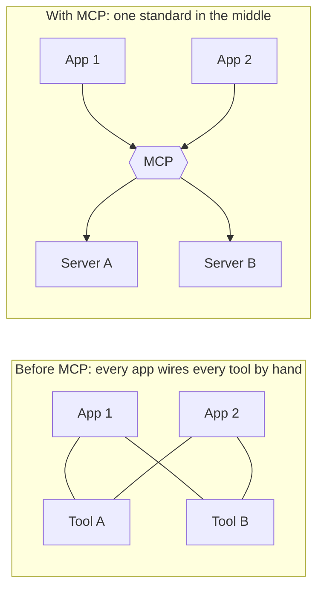
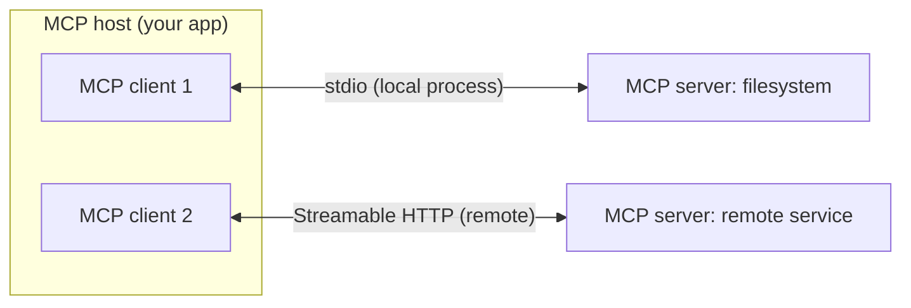
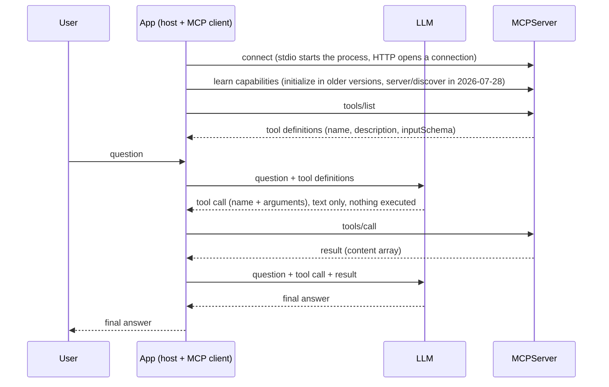
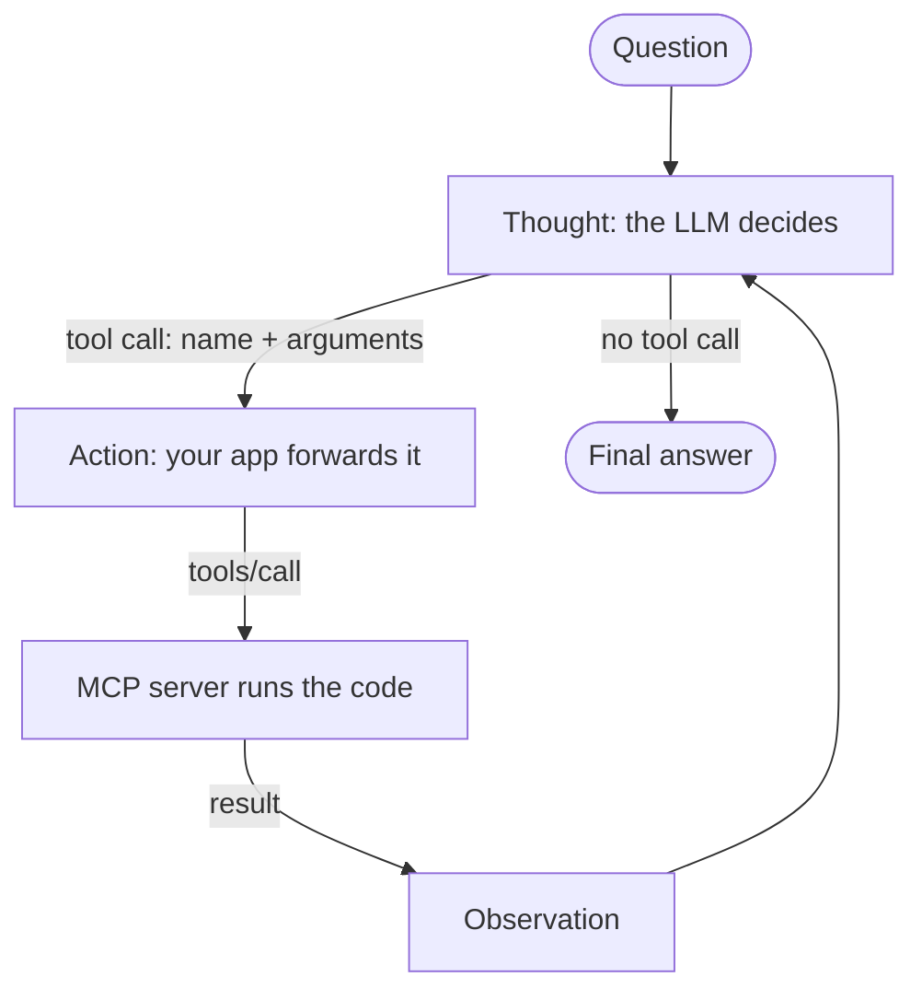

# Model Context Protocol (MCP)

Notes from the MCP chapter of the course. The concepts follow the official MCP documentation , and the code behavior was checked by running it.

---

## 1. What MCP is, in one minute

MCP is an open standard for connecting AI applications to external systems: files, databases, search engines, APIs, other tools. The official introduction compares it to a USB-C port. One standard plug means any application can connect to any system that speaks the standard.

MCP is a protocol and nothing more. It defines how an application asks a server "what can you do?" and "please do this", and what the answers look like. It does not decide how the LLM is used or how context is managed. That stays the application's job.

## 2. Why it exists

Without a standard, every application wires every tool by hand. With 5 applications and 8 tools that is up to 40 custom integrations. With a standard in the middle it is 5 clients plus 8 servers.



This is the same idea as the `@tool` decorator and `bind_tools` from earlier lessons, one level up. Those standardize how a model asks for a tool inside one codebase. MCP standardizes how any application finds and runs tools that live in separate programs.

## 3. The three participants

| Participant | What it is | Example |
|---|---|---|
| **Host** | The AI application the user talks to. It coordinates one or more clients. | A LangChain agent app, VS Code, Claude |
| **Client** | A component inside the host that keeps one connection to one server. | Created by the host, one per server |
| **Server** | A program that provides context or tools to clients. | A filesystem server, a weather server |



One client per server. In the course's sequence diagram, "App" means the host and its client together.

## 4. Two layers, two transports

- **Data layer:** JSON-RPC 2.0 messages. It defines what the messages mean: listing tools, calling a tool, and so on.
- **Transport layer:** how the bytes travel and how authentication works.

| Transport | Where the server runs | Typical use |
|---|---|---|
| **stdio** | On your machine, started by the client as a child process | Local tools, one client |
| **Streamable HTTP** | Anywhere on the network | Remote servers, many clients, authentication |


## 5. What a server can expose

| Primitive | Meaning |
|---|---|
| **Tools** | Functions the model can call, with user approval |
| **Resources** | Data the application can read as context |
| **Prompts** | Reusable prompt templates |

On the client side, the architecture page lists elicitation, where a server asks the user for input. Older tutorials also mention sampling and logging, which that page marks as deprecated in this version.

## 6. A tool, concretely

An MCP tool is described by a name, a description, and an input schema (JSON Schema). The model never sees your Python function. It sees this description, which is why the description matters so much.

A minimal server, following the official build-a-server page:

```python
from mcp.server import MCPServer

mcp = MCPServer("weather")


@mcp.tool()
def get_forecast(city: str) -> str:
    """Get a short weather forecast for a city.

    Args:
        city: City name, for example Cairo
    """
    return f"Sunny, 31 C in {city}"


if __name__ == "__main__":
    mcp.run(transport="stdio")
```

`MCPServer` comes from `mcp` 2.x. In `mcp` 1.x the same server is written with `from mcp.server.fastmcp import FastMCP` and `FastMCP("weather")`. Older tutorials use that form.

What the SDK built from the function, as seen through the LangChain adapter:

| MCP tool field | Where it came from | Observed value |
|---|---|---|
| name | the function name | `get_forecast` |
| description | the docstring | `Get a short weather forecast for a city. ...` |
| input schema | the type hints | `{'city': {'title': 'City', 'type': 'string'}}` |

Reading it from a client with the adapter:

```python
import asyncio
from langchain_mcp_adapters.client import MultiServerMCPClient


async def main():
    client = MultiServerMCPClient({
        "weather": {"command": "python", "args": ["server.py"], "transport": "stdio"},
    })
    tools = await client.get_tools()
    print(tools[0].name, tools[0].args)
    print(await tools[0].ainvoke({"city": "Cairo"}))


asyncio.run(main())
```

Observed output:

```
get_forecast {'city': {'title': 'City', 'type': 'string'}}
[{'type': 'text', 'text': 'Sunny, 31 C in Cairo', 'id': 'lc_...'}]
```

The result is a list of content blocks, the same shape as Gemini's `response.content` from earlier lessons. It comes from the `content` array in an MCP tool result.

## 7. The full flow, step by step

The course's sequence diagram, with the real message names added:




### It is the ReAct loop already built



| In  earlier code | In MCP |
|---|---|
| `ai_message.tool_calls` | the LLM's tool call, unchanged |
| `tools_dict[name].invoke(args)` or `ToolNode` | the client sends `tools/call` |
| the Python function body runs in your process | the function body runs **in the server process** |
| `ToolMessage` | the tool result, converted by the adapter |

The loop did not change. Only the "execute" step moved out of your process, into a server.

**The LLM executes nothing, and neither does your agent app.** The model writes a request. The app forwards it. The MCP server is the only component that runs the tool's code.

## 8. Why `*decouple*` tool execution

- **Scale and deploy separately.** The tool service can run on its own infrastructure, with its own scaling.
- **Monitor separately.** Tool calls can be logged and measured as a service.
- **Reuse.** One server works with any MCP client.
- **Independent versions and languages.** Tested: a client on `mcp` 1.30 with `langchain-mcp-adapters` 0.3.2 called a server built with `mcp` 2.3 and the official `MCPServer` class, and it worked.


## 9. LangChain MCP adapters

The adapter converts each MCP tool into a normal LangChain tool, so `create_agent`, `ToolNode`, and `bind_tools` work with it unchanged.

```python
import asyncio

from dotenv import load_dotenv
from langchain.agents import create_agent
from langchain_google_genai import ChatGoogleGenerativeAI
from langchain_mcp_adapters.client import MultiServerMCPClient

load_dotenv()


async def main():
    client = MultiServerMCPClient({
        "weather": {
            "command": "python",
            "args": ["server.py"],
            "transport": "stdio",
        },
    })
    tools = await client.get_tools()

    agent = create_agent(ChatGoogleGenerativeAI(model="gemini-3.6-flash"), tools)
    result = await agent.ainvoke(
        {"messages": [{"role": "user", "content": "What is the weather in Cairo?"}]}
    )
    print(result["messages"][-1].content)


asyncio.run(main())
```


### Behaviors verified by running code

1. **MCP tools are async only.** Calling `tool.invoke(...)` raises `NotImplementedError: StructuredTool does not support sync invocation.` Use `await tool.ainvoke(...)` and `await agent.ainvoke(...)`.
2. **By default, each tool call starts a new server process.** A server with a counter returned `calls=1` twice, with two different process ids. Inside `async with client.session("name") as session:` plus `load_mcp_tools(session)`, the process stayed alive and the counter reached `calls=2`. Use a session when the server keeps state or starts slowly.
3. **Version pins.** `langchain-mcp-adapters` 0.3.2 requires `mcp>=1.24,<2`, while the official 2026-07-28 snippet needs `mcp` 2.x. Forcing `mcp` 2.3 next to the adapters failed with `ImportError: cannot import name 'RequestContext' from 'mcp.shared.context'`. Two ways out: write the server with `FastMCP` in the same project, or keep the server in its own project and start it through `command` (which worked in the cross-version test).
4. **Results are content blocks, not strings.** Handle them like Gemini's `content`.
5. **A stray `print()` in a stdio server did not break my test.** The docs warn that stdout is the protocol channel for stdio servers and that writing to it can corrupt messages. I could not reproduce a failure with the 1.30 SDK, but do not rely on that. Log to stderr or a file.

## 10. Security

### From the official Security Best Practices page

| Threat | What happens | Defense |
|---|---|---|
| **Confused deputy** | An MCP proxy that uses one fixed OAuth client ID toward a third-party service can be tricked into handing an authorization code to an attacker, because the third party skips consent it already recorded | The proxy asks the user for consent per client, validates redirect URIs exactly, and protects the flow with a `state` value |
| **Token passthrough** | A server accepts a token that was not issued for it and forwards it to another API. This is explicitly forbidden | Accept only tokens issued for this server, and call downstream services with separate credentials |
| **SSRF** | A client follows URLs from server-provided metadata and ends up requesting internal addresses such as localhost or cloud metadata endpoints | HTTPS only, block private and link-local ranges, validate redirects, use an egress proxy |
| **State handle hijacking** (called session hijacking in older versions) | An attacker who obtains the identifier for server-side state acts as the user | Never treat the identifier as authentication. Verify credentials on every request and use unpredictable identifiers |
| **Local server compromise** | A local server is a program running with your privileges, and a careless one-click setup can run arbitrary commands | Show the exact command and require explicit consent, sandbox the server, limit filesystem and network access, prefer stdio for local servers |
| **Scope minimization** | Requesting broad permissions up front makes a stolen token far more damaging | Request the smallest scope first and add more only when needed |

The page also covers OAuth details such as authorization URL validation and mix-up attacks.

### part of working with LLMs (general practice)

- **Prompt injection through tools.** Tool descriptions and tool results are text that goes into the model's context. If that text contains instructions, the model may follow them. Treat both as untrusted input.
- **Least privilege and approval.** Give a server only the access it needs, and require human approval for actions that write, delete, or spend.
- **Context cost.** Every tool definition takes tokens. Connecting many servers fills the context window, which connects to the context engineering notes.

### What this means for my setup

- A stdio server is a process on my machine with my permissions. Only run servers I wrote or trust, and read the `command` in any configuration before using it.
- A remote server receives the tool arguments, so data leaves my machine. This is the same concern as the privacy and data retention chapter.
- A local stdio server keeps the data on the machine, which fits the local-first stack used across these projects.
- Secrets go into environment variables for the server process, not into tool arguments or prompts.

## 11. Common mistakes

- A missing or vague tool description, so the model never picks the tool.
- Using `invoke` instead of `ainvoke` with MCP tools.
- Assuming a server keeps state between calls when the adapter starts a new process each time.
- Mixing SDK versions in one project (section 9).
- Connecting many servers and flooding the context with tool definitions.
- Trusting a server just because it speaks MCP.

## 12. Self-check 

| Question | Answer | Notes |
|---|---|---|
| What is MCP for? | Integrating LLM applications with external data sources and tools | The 2026-07-28 intro words it as an open standard for connecting AI applications to external systems |
| What does an MCP server do? | Exposes capabilities such as tools, resources, and prompts over the protocol | |
| Where do servers run? | Locally (stdio) or remotely (Streamable HTTP) | |
| What executes the tool code? | The MCP server | Not the LLM and not the client |
| What must a tool definition include for the LLM to use it well? | A clear description, plus an input schema | The description is injected into the model's prompt |
| Benefit of decoupling execution? | Separate scaling, monitoring, and deployment | Also reuse across clients and independent SDK versions |
| What do the LangChain MCP adapters do? | Convert MCP tools into LangChain tools | So agents and `ToolNode` use them unchanged |

## 13. Some questions

1. **What problem does MCP solve?** It replaces N by M custom integrations with N clients plus M servers speaking one protocol.
2. **Host, client, server?** The host is the application, the client is its connection to one server, the server provides the tools.
3. **Who executes a tool?** The MCP server. The LLM only emits a request.
4. **stdio versus Streamable HTTP?** stdio starts a local child process for one client. Streamable HTTP serves remote clients and supports authentication.
5. **MCP versus function calling?** Function calling is how a model asks for a tool call. MCP is how an application discovers and runs tools from separate servers. They compose: tool definitions go to the model through function calling, and the model's call is forwarded with `tools/call`.
6. **What are the server primitives?** Tools, resources, prompts.
7. **Main risk of a local server?** It runs with the user's privileges, so an untrusted or careless server can run arbitrary commands.
8. **What is token passthrough, and why is it forbidden?** Forwarding a token that was not issued for the server. It bypasses security controls and breaks accountability.
9. **Why use the LangChain adapter?** It makes MCP tools look like normal LangChain tools, so existing agent code needs no changes.


## Sources

- [MCP introduction](https://modelcontextprotocol.io/docs/2026-07-28/getting-started/intro)
- [MCP architecture overview](https://modelcontextprotocol.io/docs/2026-07-28/learn/architecture)
- [Build an MCP server](https://modelcontextprotocol.io/docs/2026-07-28/develop/build-server)
- [Security best practices](https://modelcontextprotocol.io/docs/2026-07-28/tutorials/security/security_best_practices)
- [LangChain MCP documentation](https://docs.langchain.com/oss/python/langchain/mcp)
- [langchain-mcp-adapters](https://github.com/langchain-ai/langchain-mcp-adapters)